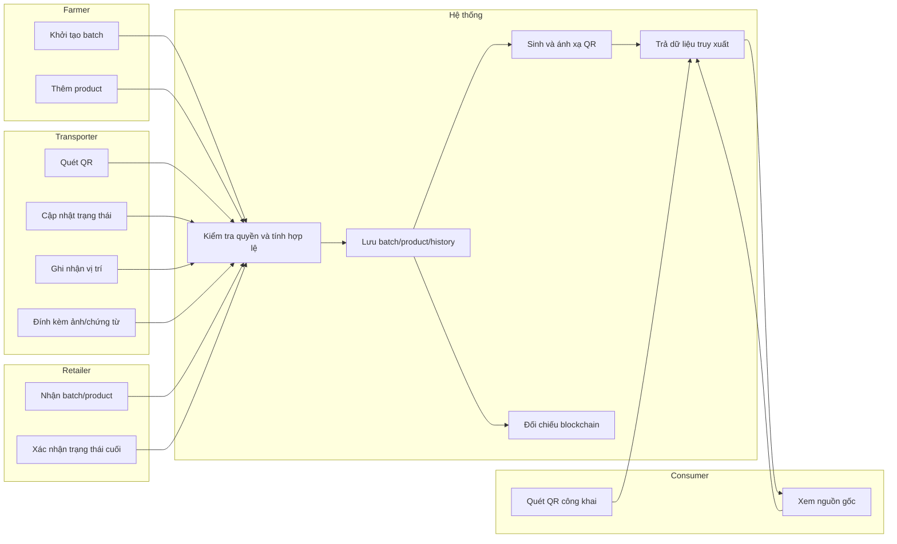
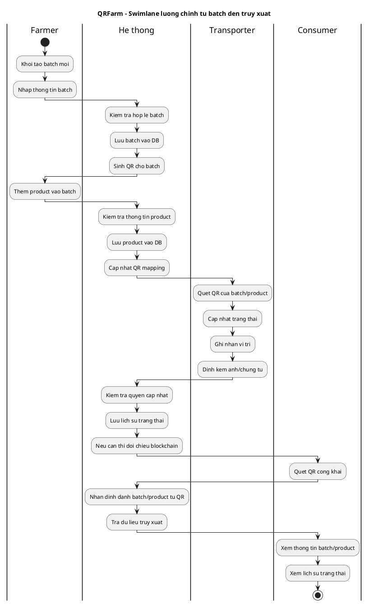
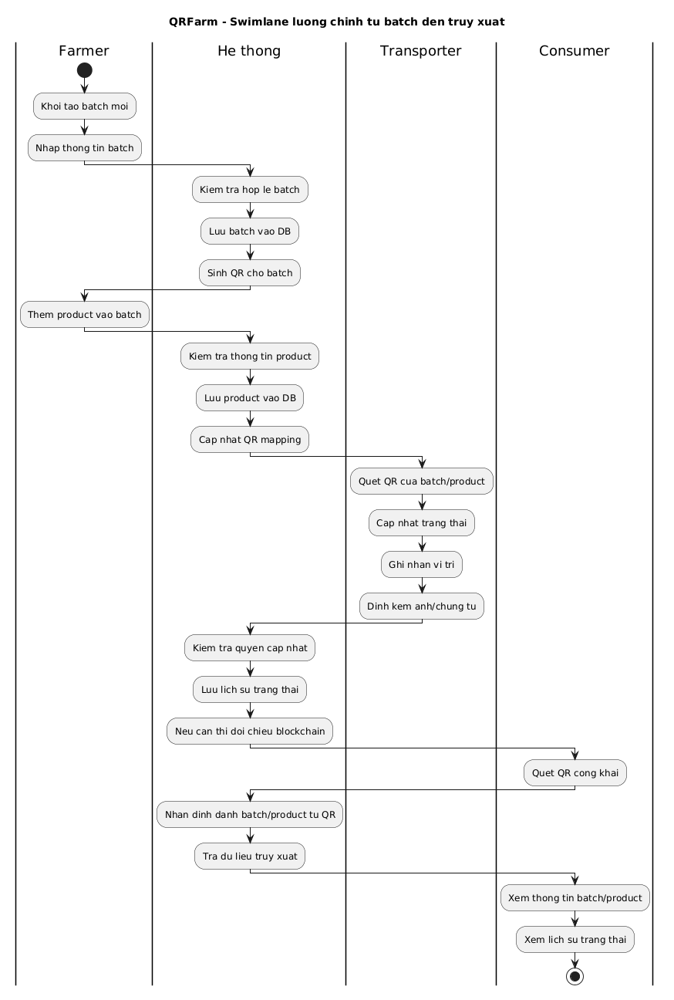

# BPMN - Hệ thống QRFarm

## 1. Quy trình tổng thể

## 2. Swimlane PlantUML cho luồng chính

Luồng dưới đây mô tả chuỗi nghiệp vụ quan trọng nhất của QRFarm: tạo batch, thêm product, cập nhật trạng thái vận chuyển, và consumer quét QR để truy xuất nguồn gốc.

## 3. Quy trình tạo batch và product

1. Farmer khởi tạo batch mới trên app hoặc màn hình vận hành.
2. Hệ thống kiểm tra dữ liệu batch.
3. Hệ thống lưu batch vào DB và sinh QR.
4. Farmer thêm product vào batch.
5. Hệ thống lưu product, liên kết với batch cha và sinh QR nếu cần.
6. Mốc tạo mới có thể được đẩy sang lớp blockchain xác thực phụ.

## 4. Quy trình cập nhật vận chuyển

1. Transporter quét QR của batch hoặc product.
2. Hệ thống xác định đúng thực thể cần cập nhật.
3. Transporter nhập trạng thái mới, vị trí và chứng từ.
4. Hệ thống kiểm tra quyền, kiểm tra tính hợp lệ và lưu lịch sử.
5. Nếu cần, hệ thống gửi mốc nghiệp vụ sang blockchain.

## 5. Quy trình tra cứu công khai

1. Consumer quét QR hoặc mở link truy xuất.
2. Web gọi backend để lấy dữ liệu batch hoặc product.
3. Backend trả về thông tin chính, lịch sử trạng thái và vị trí hiện tại.
4. Web hiển thị thông tin theo dạng dễ đọc cho người tiêu dùng.

## 6. Quy trình đối chiếu blockchain

1. Backend chọn các mốc quan trọng cần xác thực.
2. Dữ liệu được chuẩn hóa trước khi gửi sang lớp blockchain.
3. Blockchain ghi nhận hoặc đối chiếu dấu vết.
4. Hệ thống nhận phản hồi và đánh dấu trạng thái xác thực.
5. Nếu blockchain lỗi, luồng nghiệp vụ chính vẫn tiếp tục hoạt động.
